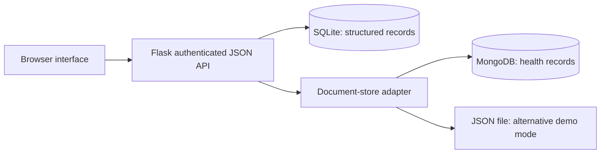
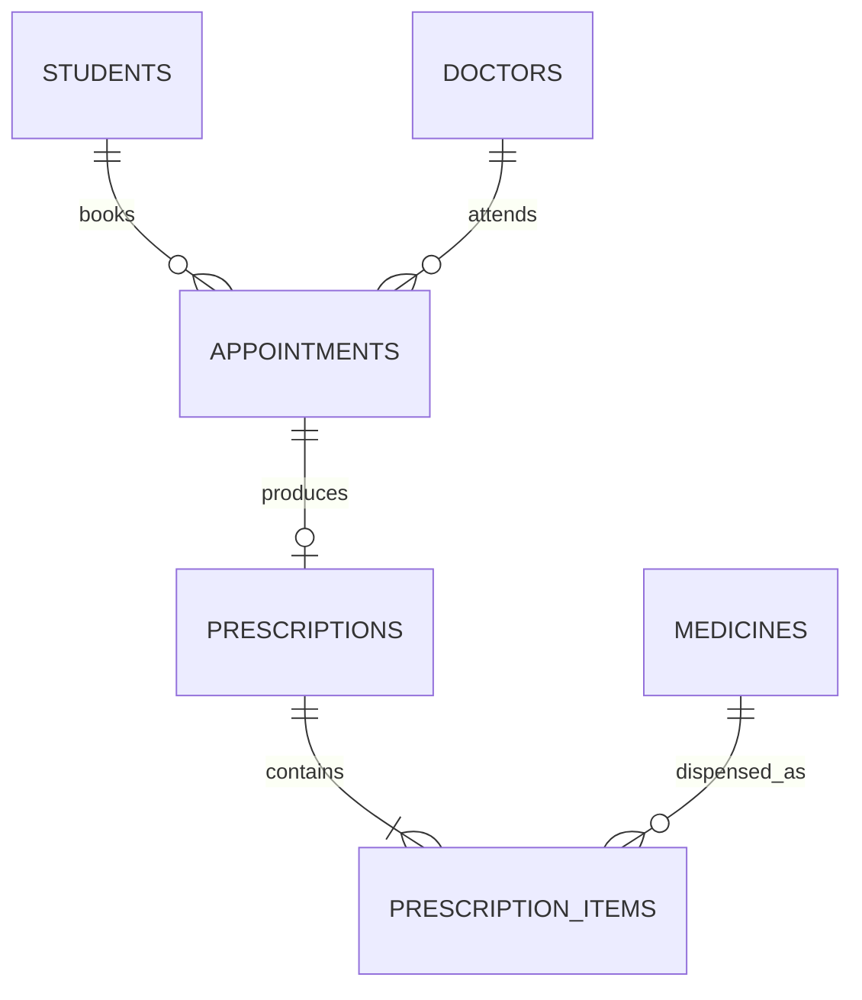

# CampusCare — project design and demonstration report

## 1. Objective

CampusCare centralizes college health-centre information: student profiles, doctor schedules, consultation prescriptions, medicine inventory, and longitudinal healthcare notes. Its dashboard turns operational records into useful summaries for the campus care team.

## 2. Technology and architecture

The browser renders HTML, CSS, and JavaScript and exchanges JSON with a Python Flask application. SQLite stores structured, linked records. MongoDB stores flexible clinical-note documents when configured. A local JSON adapter enables an offline demonstration without a database service.



Only one document backend is active at a time. Both adapters implement note creation, listing, student filtering, and tag counts.

## 3. Relational database design



| Table | Key fields and purpose |
|---|---|
| users | ID, unique username, password hash |
| students | ID, unique student number, name, email, department, blood group, allergies |
| doctors | ID, name, specialty, email |
| appointments | ID, student and doctor foreign keys, scheduled time, reason, constrained status |
| medicines | ID, unique medicine/batch name, stock, unit, reorder level, expiry date |
| prescriptions | ID, unique appointment foreign key, diagnosis, instructions, timestamp |
| prescription_items | ID, prescription and medicine foreign keys, quantity, dosage |

Normalization separates repeating prescription medicines into line items and stores student and doctor details once. Foreign keys prevent orphaned SQL records. Check constraints protect nonnegative stock and valid statuses. Partial unique indexes prevent simultaneous non-cancelled slots for either a student or doctor. The `appointment_details` view centralizes joins used by the UI.

## 4. NoSQL document design

Example healthcare note:

```json
{
  "id": "generated-uuid",
  "student_id": 1,
  "title": "Wellness follow-up",
  "notes": "Fictional demonstration note.",
  "tags": ["follow-up", "wellness"],
  "author": "admin",
  "created_at": "2026-10-12T04:00:00+00:00"
}
```

The API verifies that `student_id` exists in SQLite before inserting a note. MongoDB is useful for nested and variable document structures; the current UI intentionally exposes a small consistent note shape. A compound index supports student history lookup ordered by time. Tags have their own index.

## 5. Advanced queries and analytics

### A. Relational joins and aggregation

```sql
SELECT s.department, COUNT(DISTINCT s.id) AS students, COUNT(a.id) AS visits
FROM students s
LEFT JOIN appointments a
  ON a.student_id = s.id AND a.status != 'Cancelled'
GROUP BY s.department
ORDER BY visits DESC;
```

This includes students without appointments and excludes cancelled visits. `DISTINCT` prevents the join from inflating the student count.

### B. Common table expression and window-function ranking

```sql
WITH workload AS (
  SELECT d.name, COUNT(a.id) AS appointments,
         SUM(CASE WHEN a.status = 'Completed' THEN 1 ELSE 0 END) AS completed
  FROM doctors d
  LEFT JOIN appointments a ON a.doctor_id = d.id AND a.status != 'Cancelled'
  GROUP BY d.id
)
SELECT *, DENSE_RANK() OVER (ORDER BY appointments DESC) AS rank
FROM workload
ORDER BY rank, name;
```

Doctors with equal appointment counts receive the same rank without gaps. This measures recorded workload, not quality of care.

### C. Time-series aggregation

```sql
SELECT substr(scheduled_at, 1, 7) AS month, COUNT(*) AS visits
FROM appointments
WHERE status != 'Cancelled'
GROUP BY month
ORDER BY month;
```

The chart includes all recorded months, including scheduled future visits. Months with no recorded visits are omitted.

### D. MongoDB aggregation pipeline

```javascript
db.health_records.aggregate([
  { $unwind: "$tags" },
  { $group: { _id: "$tags", count: { $sum: 1 } } },
  { $sort: { count: -1, _id: 1 } },
  { $project: { _id: 0, tag: "$_id", count: 1 } }
]);
```

The API normalizes tags to lowercase and removes duplicates within each note. Thus the count represents documents containing a tag. Tags describe recorded themes and do not establish diagnosis prevalence.

## 6. Transactional dispensing

1. Validate the request and its medicine lines.
2. Acquire an SQLite write transaction using `BEGIN IMMEDIATE`.
3. Verify that the appointment exists and is not cancelled.
4. Insert one prescription for the appointment.
5. Reject expired medicines and reduce stock only where sufficient stock exists.
6. Insert line items and complete the appointment.
7. Commit all changes, or roll back every change if any step fails.

Conditional stock updates prevent negative inventory. The write transaction protects concurrent dispensing. A unique appointment constraint prevents accidental duplicate prescriptions. Document notes are separate writes and do not participate in the dispensing transaction.

## 7. API summary

| Method | Route | Purpose |
|---|---|---|
| GET | /api/session | Session state and CSRF token |
| POST | /api/login, /api/logout | Authentication lifecycle |
| GET, POST | /api/students | List and create students |
| PUT | /api/students/{id} | Edit profile |
| GET, POST | /api/doctors | List and create doctors |
| PUT | /api/doctors/{id} | Edit doctor |
| GET, POST | /api/appointments | List and book visits |
| PATCH | /api/appointments/{id} | Complete or cancel a scheduled visit |
| GET, POST | /api/medicines | List and create inventory batches |
| POST | /api/medicines/{id}/restock | Increase same-batch stock |
| GET, POST | /api/prescriptions | List or atomically dispense a prescription |
| GET, POST | /api/records | List or create documents; optional student_id query |
| GET | /api/analytics | Combined SQL and document analytics |

All domain routes require login. Mutating API calls require the session's `X-CSRF-Token` header. Validation returns HTTP 400; unauthorized calls 401; invalid CSRF 403; constraint conflicts 409.

## 8. Evaluation and future work

Automated tests cover the core integrity and persistence rules. Manual browser checks verify login and dashboard navigation. MongoDB service integration needs a locally running or authorized hosted MongoDB instance for live verification.

Future extensions could include doctor/student roles, an audited correction workflow, inventory batch selection, appointment rescheduling, attendance reports, encrypted backups, notifications, and formal deployment hardening. The current implementation is a college demonstration rather than a certified clinical system.
